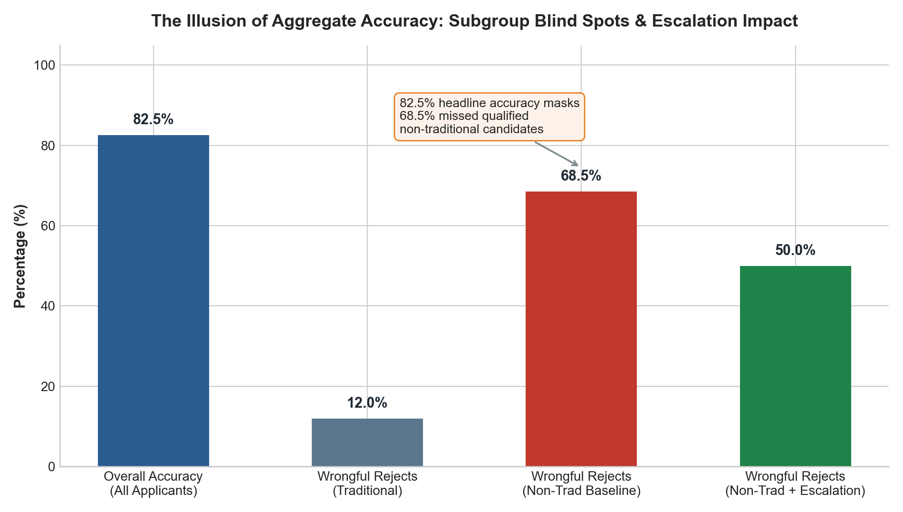
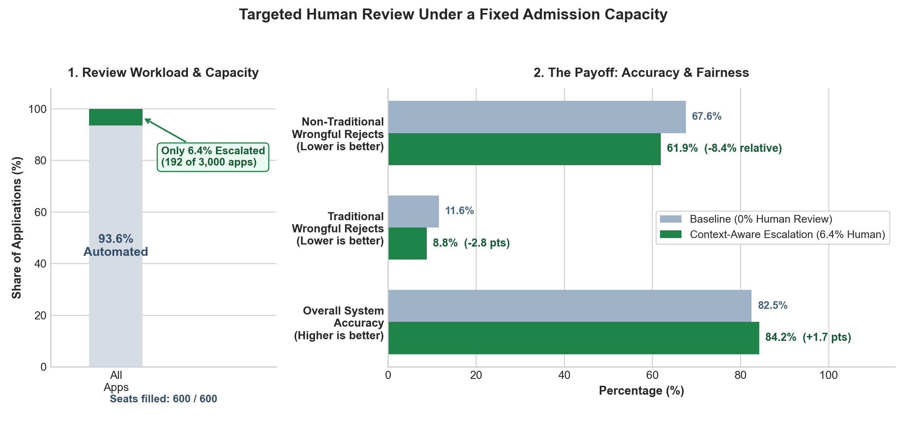
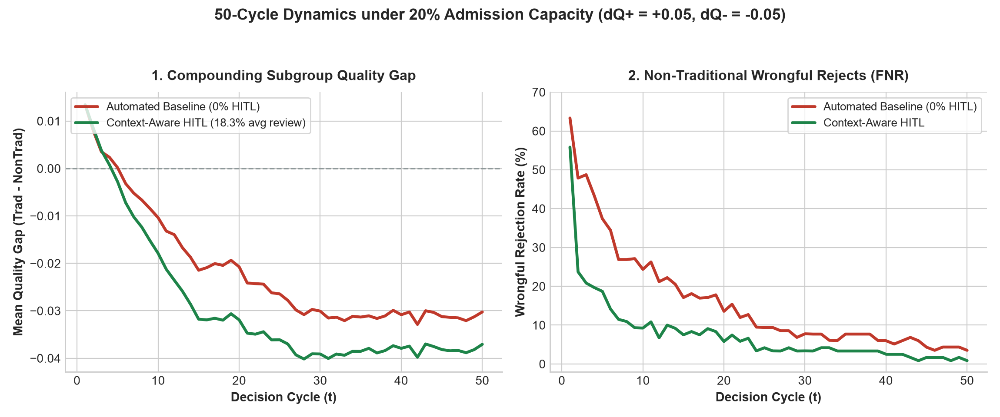

# Selective Admissions Model Validation & Escalation Sandbox

[](https://colab.research.google.com/github/jasongoldfarb/admissions-validation-sandbox/blob/main/walkthrough.ipynb)

A self-contained Python model-validation sandbox exploring **why strong headline accuracy can hide subgroup blind spots**—and how a **human-in-the-loop review band** ("letting the model say *I'm not sure*") reduces wrongful auto-rejections on applicants whose qualitative context gets flattened by quantitative snapshots.

👉 **Want to explore interactively?** Open [`walkthrough.ipynb`](walkthrough.ipynb) directly on GitHub to read the pre-rendered tables and charts, or click the **Open in Colab** badge above to run the operational sensitivity sandbox in your browser with zero local setup.

Built as a low-friction **winter-break / New Year's coding sandbox** for data scientists, analysts, and curious builders.

## Empirical Priors & Simulation Grounding

The applicant generator in `src/baseline_repro.py` and the 50-cycle extension in `src/longitudinal_sim.py` are anchored to the empirical priors and Table 2 parameters used in **Ray, Padmanabhan, and Bouayad (INFORMS Journal on Computing, `INFORMSJoC/2023.0523`)**:
- **Subgroup share (NCES):** `1 - 7.8 / 15.4` (~49.4% non-traditional / underrepresented).
- **SAT distribution (College Board):** Mean `1030`, SD `235`, rounded to the nearest 10.
- **Equal underlying talent:** Identical academic and non-academic quality distributions (`N(0.5, 0.1)`) across cohorts.
- **Selectivity threshold:** Top `20%` admit bar (`Tau1 = 20` Tier-1 cutoff).
- **Longitudinal dynamics (Table 2):** `n = 1,000` individuals, `t = 50` recurring selection cycles, `∆Q+ = +0.05` (reward for admitted & qualified), `∆Q- = -0.05` (penalty for admitted & unqualified).

To test human-in-the-loop escalation at the single-institution level, the sandbox translates the paper's group-level evaluation noise gap into concrete flattened-context variables (school AP caps, outside work/caregiving hours, and upward grade trajectories).

## Key Findings (Simulated Holdout, N = 3,000)

- **Headline accuracy looks reassuring—and even deceptive:** The baseline screener trained on biased historical admissions data reaches **82.5% overall accuracy** (**81.8%** on traditional applicants and **83.2%** on non-traditional applicants).
- **Subgroup blind spot:** Despite higher cohort accuracy, qualified **non-traditional applicants** face a **68.5%** wrongful auto-rejection rate (false negative rate), compared to **12.0%** for traditional applicants.
- **Flattened context:** **206 of the 230** missed non-traditional candidates get pushed into the lowest predicted-probability bucket (`< 0.20`) because raw counts (APs taken, club leadership, cumulative GPA) miss school AP caps, heavy outside work/caregiving hours, and upward grade trajectories.
- **Cohort-blind, context-triggered escalation:** Routing applicants using **observable educational and life constraints**—applying a lower `[0.04, 0.65]` review floor when a student's school offers `<= 6` APs or they work/caregive `>= 10` hours/week, and `[0.20, 0.65]` otherwise (assuming **92%** human review accuracy)—escalates just **6.4%** of applications (193 of 3,000). Without changing the underlying scoring model, this cuts non-traditional wrongful auto-rejections from **68.5% to 50.0%** (a **27.0% relative drop**), trims traditional wrongful rejections from **12.0% to 8.4%**, and lifts overall accuracy from **82.5% to 85.5%**.
- **50-cycle compounding dynamics (`src/longitudinal_sim.py`):** Extending the audit across `t = 50` recurring cycles (`n = 1,000`, retraining on admitted outcomes) shows how single-cycle screening bias compounds into a self-fulfilling prophecy. Under the **Automated Baseline (0% HITL)**, the subgroup quality gap (`Trad - NonTrad`) more than triples (`+0.0134` → `+0.0426`) even as headline accuracy climbs to `98.9%` because early winners lock into the top 20%. Under **Context-Aware Escalation (15.0% avg review)**, the widening quality gap is neutralized (`+0.0134` → `-0.0144`) and non-traditional wrongful rejections fall from `38.8%` to `0.0%`.

## Charts







## Quickstart

```bash
git clone [https://github.com/jasongoldfarb/admissions-validation-sandbox.git](https://github.com/jasongoldfarb/admissions-validation-sandbox.git)
cd admissions-validation-sandbox
pip install -r requirements.txt

python src/baseline_repro.py
python src/audit_borderline.py
python src/escalation_policy.py
python src/longitudinal_sim.py
python src/make_charts.py
```

Or launch the interactive notebook locally:

```bash
jupyter notebook walkthrough.ipynb
```

## Project Structure

For module-level documentation, function signatures, and parameter details, see [`src/README.md`](src/README.md).

```text
admissions-validation-sandbox/
├── src/
│   ├── __init__.py             # Enables clean module imports from walkthrough.ipynb
│   ├── README.md               # Module-level reference for all 5 pipeline scripts
│   ├── baseline_repro.py       # Session 1: Baseline simulation (paper priors) & subgroup metrics
│   ├── audit_borderline.py     # Session 2: Score-zone slice & flattened-context audit
│   ├── escalation_policy.py    # Session 3: Observable context-proxy review band simulation
│   ├── make_charts.py          # Session 4: Generate PNG visuals from simulation outputs
│   └── longitudinal_sim.py     # Session 5: 50-cycle longitudinal dynamics (Table 2 extension)
├── tests/
│   ├── test_baseline_repro.py
│   ├── test_audit_borderline.py
│   ├── test_escalation_policy.py
│   ├── test_make_charts.py
│   └── test_longitudinal_sim.py
├── outputs/                    # Generated CSVs and PNG charts
├── walkthrough.ipynb           # End-to-end narrated walkthrough & operational sensitivity sandbox
├── requirements.txt
└── README.md
```

## Running Tests

Run the `pytest` suite (32 tests verifying seed reproducibility, schema/bounds, longitudinal update math, edge cases, and isolated chart generation without modifying `outputs/`):

```bash
python -m pytest -v
```

## Limitations & Real-World Nuances

- **Fixed seat capacity & yield:** Rescuing more qualified applicants via human review increases total admits in this unconstrained sandbox. At a selective university with a fixed freshman class size and yield target, lowering false negatives requires tightening the auto-admit bar or managing a waitlist (trading off FNR against FPR/over-enrollment risk).
- **Idealized human review:** `src/escalation_policy.py` models human readers with a symmetric **92%** accuracy rate across cohorts. Real admissions committees experience reader fatigue, inter-rater variance, and their own cognitive biases.
- **Post-hoc escalation vs. upstream feature engineering:** Even after targeted escalation, **50.0%** of qualified non-traditional applicants remain auto-rejected below `0.04`. In production, context-aware escalation should be paired with upstream feature engineering (such as replacing raw AP counts with `ap_utilization = ap_courses_taken / school_ap_cap`).

## "Try This Next" Winter Break Challenge

1. **Test human review accuracy sensitivity:** Edit `human_acc` in `walkthrough.ipynb` (Section 5) or `src/escalation_policy.py` (e.g., `0.85` vs. `0.95`)—at what human review accuracy does escalating borderline cases stop improving overall accuracy?
2. **Hidden Confounder / Omitted Variable Experiment:** Add an unmeasured **legacy / institutional-familiarity boost** into `historical_admit` without exposing it to the model. How does that shift the decision boundary and change which applicants land inside or outside the review band?
3. **Capacity-Constrained Escalation:** Suppose human admissions readers can only review **5%** of total applications. Design a ranking or context-triggered rule to pick *which* 5% get human eyes first.

## Research Attribution

This sandbox is inspired by and anchored to the empirical priors in the systemic fairness research of **Arindam Ray, Balaji Padmanabhan, and Lina Bouayad**:
- *INFORMS Journal on Computing* simulation repository: https://github.com/INFORMSJoC/2023.0523
- *Systemic Fairness* (`arXiv:2304.06901`): https://arxiv.org/pdf/2304.06901.pdf